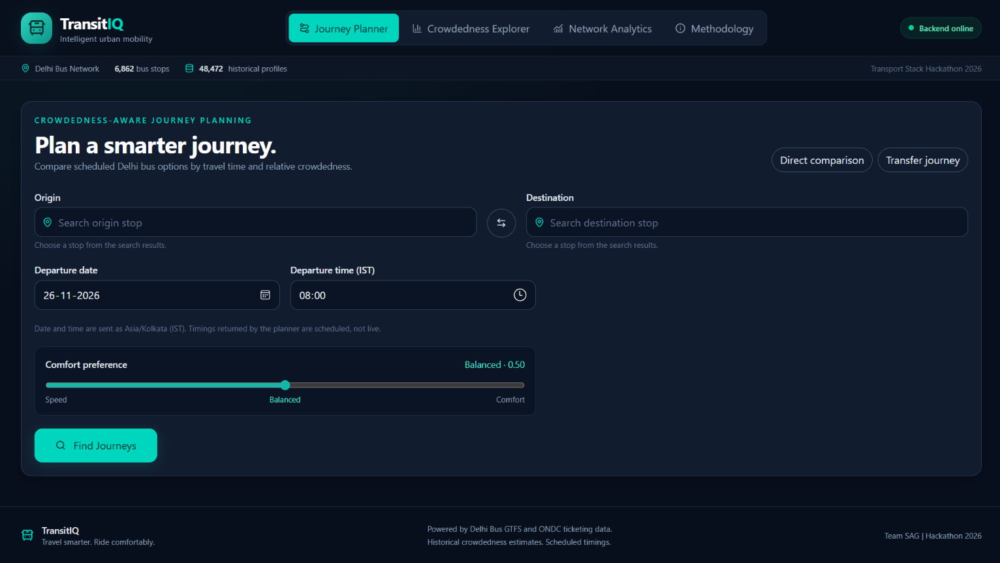
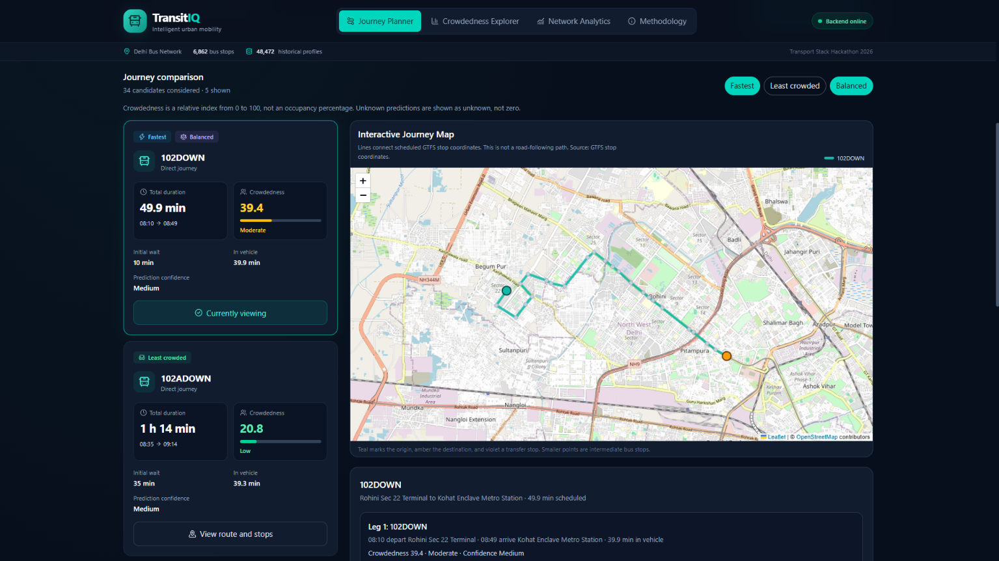
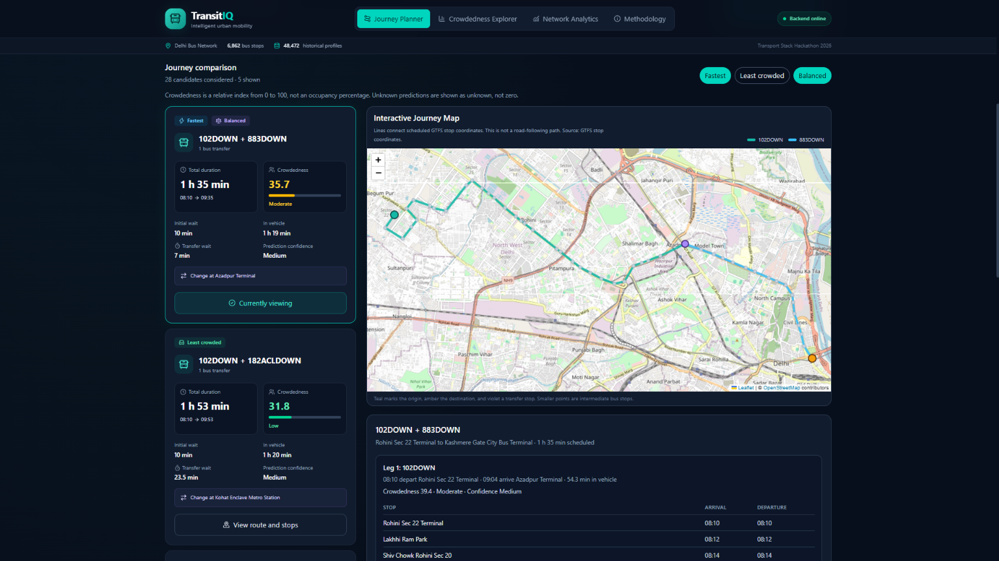
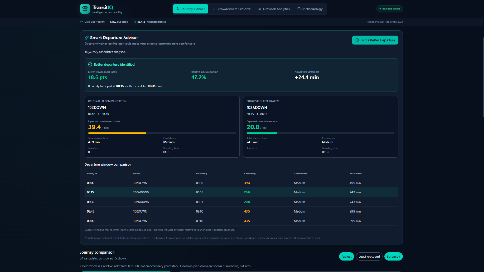
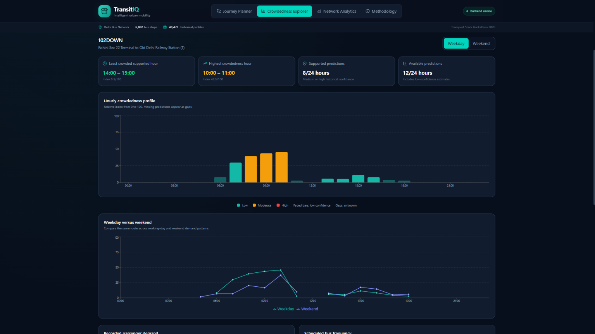
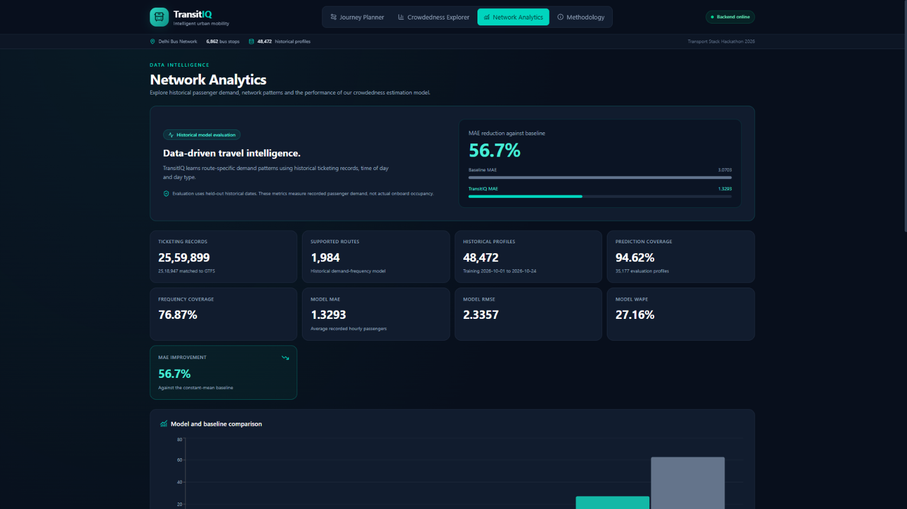
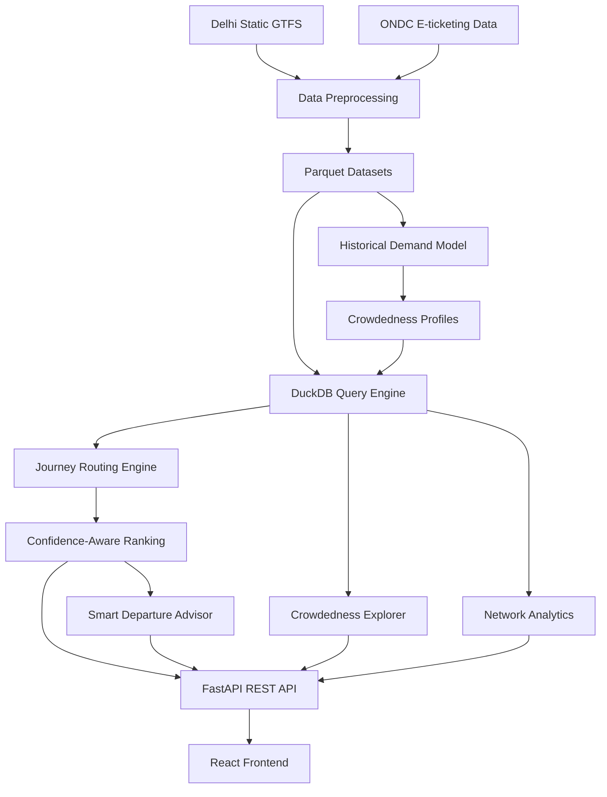


# TransitIQ

### Travel Smarter. Ride Comfortably.

**Crowdedness-aware intelligent journey planning for Delhi's public bus network.**


**Transport Stack Hackathon 2026 | Problem Statement 2**

**Team SAG**

---

## Overview

Traditional journey planners primarily optimize travel time, ignoring how crowded a public transport journey might be.

TransitIQ introduces crowdedness as an additional dimension of journey planning, enabling commuters to make informed decisions based on scheduled travel time, expected crowdedness, prediction confidence and departure flexibility.

The platform uses real-world Delhi bus GTFS schedules and October 2026 ONDC e-ticketing records to estimate historical passenger demand and construct frequency-adjusted crowdedness predictions.

TransitIQ goes beyond route selection by helping commuters decide when to travel.

---

## Project Highlights

| Metric | Result |
|---|---:|
| Original ticketing records analysed | 2,559,899 |
| Usable matched ticketing records | 2,518,947 |
| Recorded passengers in matched data | 2,709,551 |
| Supported route keys | 1,984 |
| GTFS bus stops | 6,862 |
| Scheduled trips in GTFS | 80,357 |
| Historical prediction profiles | 48,472 |
| Prediction models benchmarked | 4 |
| MAE improvement over constant baseline | 56.7% |
| Historical observed-profile coverage | 94.62% |
| Automated backend tests passed on Windows | 30 |

---

## Problem Statement

Crowdedness shapes how commuters experience a trip, yet journey planners ignore it.

Build a model that estimates crowdedness across bus routes and times of day from about 4–5 weeks of e-ticketing and ETM data, then integrate it into a journey planner so commuters can choose routes on both travel time and expected crowdedness.

TransitIQ addresses this objective using available e-ticketing and GTFS datasets. ETM integration remains a future extension because the required ETM dataset was unavailable during development.

---

## Key Features

### 1. Crowdedness-Aware Journey Planner

- Search among 6,862 Delhi bus stops.
- Plan journeys using scheduled GTFS departures.
- Compare direct and one-transfer journeys.
- Choose between speed, balanced and comfort preferences.
- View expected crowdedness alongside travel time.
- Compare prediction confidence.
- Explore journey paths through interactive maps.

### 2. Smart Departure Advisor

TransitIQ evaluates up to five departure windows:

- Original requested departure
- 15 minutes later
- 30 minutes later
- 45 minutes later
- 60 minutes later

The advisor reuses a bounded journey candidate search instead of repeating the complete routing process for every window.

It considers:

- Expected crowdedness
- Additional arrival time
- Prediction confidence
- Transfer penalties
- Actual scheduled boarding times
- Duplicate journey alternatives

Recommendations are provided only when a meaningfully less crowded later option satisfies the defined journey-time budget.

### 3. Route Crowdedness Explorer

- Search Delhi bus routes.
- Explore 24-hour historical crowdedness profiles.
- Compare weekday and weekend patterns.
- Identify least and most crowded supported hours.
- Visualize recorded passenger demand.
- Examine scheduled bus frequency.
- Inspect hourly confidence levels.
- Distinguish unavailable estimates from low crowdedness.

### 4. Network Analytics

- Dataset statistics
- Model accuracy and validation metrics
- Peak and off-peak demand patterns
- Weekday versus weekend demand
- Crowdedness distribution
- Historical confidence distribution

### 5. Explainable Recommendations

Recommendations expose the trade-offs between travel time and relative crowdedness rather than providing an unexplained route selection.

Unknown predictions are never presented as zero crowdedness.

---

## Demonstrated Use Case

### Rohini Sec 22 Terminal to Kohat Enclave Metro Station

Requested departure: 26 November 2026, 08:00 IST

Comfort preference: 0.8

| Metric | Original Recommendation | Suggested Alternative |
|---|---|---|
| Route | 102DOWN | 102ADOWN |
| Boarding time | 08:10 | 08:35 |
| Arrival time | 08:49 | 09:14 |
| Total elapsed time | 49.9 min | 74.3 min |
| Crowdedness index | 39.4 | 20.8 |
| Crowdedness level | Moderate | Low |
| Historical confidence | Medium | Medium |

**Result:**

- 18.6-point reduction in predicted crowdedness index.
- 47.2% relative reduction in the index.
- 24.4 minutes of additional elapsed time.

This example illustrates how TransitIQ enables a commuter to evaluate whether improved expected comfort justifies a later arrival.

The reduction refers to the predicted relative index, not a measured reduction in onboard occupancy.

---


## Application Preview

### Journey Planner

Search Delhi bus stops and customize your preference between speed and comfort.



### Crowdedness-Aware Journey Recommendations

Compare scheduled journey times, relative crowdedness and historical confidence alongside interactive route maps.



### Transfer Journey Planning

Explore one-transfer journeys with individual route legs, interchange stops and scheduled waiting times.



### Smart Departure Advisor

Discover more comfortable departure alternatives. In this demonstrated journey, TransitIQ identifies a 47.2% lower relative crowdedness index in exchange for 24.4 additional minutes.



### Route Crowdedness Explorer

Explore hourly crowdedness predictions and compare weekday and weekend patterns.



### Network Analytics

Explore real-world dataset statistics, historical demand patterns and model validation results.



---

## Supporting Documentation

- [Technical Note](docs/TECHNICAL_NOTE.md)
- [Hackathon Proposal](docs/PROPOSAL.md)
- [Backend Setup Guide](docs/BACKEND_SETUP.md)
- [API Documentation](docs/API_GUIDE.md)
- [Model Benchmark Results](docs/MODEL_BENCHMARK.json)

---


## System Architecture



The application can also be packaged into a single Docker container that serves the compiled frontend and backend through one HTTP endpoint.

---

## Technology Stack

| Layer | Technologies |
|---|---|
| Frontend | React, Vite, Tailwind CSS |
| Visualization | Recharts |
| Maps | Leaflet, React Leaflet, OpenStreetMap |
| Backend | FastAPI, Uvicorn |
| Programming | Python, JavaScript |
| Data engineering | Pandas, NumPy, PyArrow |
| Analytical database | DuckDB |
| Storage | Apache Parquet |
| Model experimentation | Scikit-learn |
| Testing | Pytest, FastAPI TestClient, ESLint |
| Deployment | Docker |
| Version control | Git, GitHub |

No external database server, paid inference API or LLM API key is required.

---

## Data Engineering Pipeline

1. Load official Delhi GTFS and ONDC e-ticketing datasets.
2. Clean and normalize route identifiers.
3. Match ticketing records against GTFS routes.
4. Aggregate passenger demand by route, service date and hour.
5. Extract scheduled route-origin departures from GTFS.
6. Construct historical weekday and weekend profiles.
7. Train and validate passenger-demand prediction models.
8. Generate frequency-adjusted crowdedness indices.
9. Store processed datasets in Parquet format.
10. Query datasets through DuckDB and expose results via FastAPI.

Raw and processed datasets are intentionally excluded from version control.

---

## Crowdedness Prediction Model

### Historical Passenger Demand

Passenger demand is estimated using:

- Route identifier
- Hour of day
- Weekday or weekend

For each historical profile:

```text
Average hourly demand =
Total recorded passengers / Number of applicable days
```

Missing ticket observations are treated as zero recorded demand, not zero actual occupancy.

### Frequency Adjustment

```text
Demand per scheduled departure =
Average hourly demand / Scheduled hourly departures
```

This accounts for differences in scheduled transport supply across routes and hours.

### Crowdedness Index

```text
Crowdedness = 100 × (1 - exp(-ln(2) × D / R))
```

Where:

- D = recorded demand per scheduled departure
- R = global 95th percentile reference value

The transformation creates a bounded, comparable relative crowdedness index.

| Index | Interpretation |
|---|---|
| 0–35 | Low |
| Above 35–70 | Moderate |
| Above 70–100 | High |
| Unavailable | Unknown |

The index is not a measured occupancy percentage.

### Historical Confidence

Confidence is determined by historical observation coverage, ticket volume and frequency availability.

- High: at least 80% day coverage and 50 tickets.
- Medium: at least 40% day coverage and 10 tickets.
- Low: limited historical support.
- Unavailable: missing required frequency information or profile.

These labels represent historical data support, not calibrated statistical probabilities.

---

## Model Benchmarking

Four prediction approaches were evaluated:

- M0: Constant route-average baseline
- M1: Historical route-hour-day-type averaging
- M2: Hierarchical demand smoothing
- M3: Histogram Gradient Boosting regression

### Chronological Evaluation

| Period | Purpose |
|---|---|
| 1–17 October 2026 | Initial training |
| 18–24 October 2026 | Model selection |
| 1–24 October 2026 | Final training |
| 25–31 October 2026 | Final benchmark |

Historical ML features were constructed from earlier dates to prevent target leakage.

### Common Observed Profile Results

Evaluation profiles: 35,177

| Model | MAE | RMSE | WAPE |
|---|---:|---:|---:|
| Constant baseline | 3.0703 | 6.4841 | 62.73% |
| Historical average | 1.3293 | 2.3357 | 27.16% |
| Hierarchical smoothing | 1.3035 | 2.2941 | 26.63% |
| Gradient boosting | 1.4182 | 2.7978 | 28.98% |

### Model Selection

The historical averaging model was retained because it achieved the lowest profile MAE during the model-selection period and the lowest daily MAE in the final expanded evaluation.

Although hierarchical smoothing achieved slightly better final aggregated profile accuracy, the production model was not changed based solely on final benchmark results.

This preserves chronological model-selection discipline while maintaining simplicity, explainability and low inference overhead.

The October 25–31 period had previously been examined during original model validation, so it is not claimed to be a completely untouched holdout.

### Production Model Results

- MAE: 1.3293
- RMSE: 2.3357
- WAPE: 27.16%
- MAE reduction against constant baseline: 56.7%
- Historical observed-profile coverage: 94.62%
- Scheduled frequency coverage: 76.87%

Model accuracy measures recorded passenger demand rather than actual onboard occupancy.

Full benchmark results are available in:

[docs/MODEL_BENCHMARK.json](docs/MODEL_BENCHMARK.json)

---

## Journey Ranking

TransitIQ combines normalized additional journey time, confidence-adjusted crowdedness and transfer penalties.

```text
Ranking score = 100 × [
    (1 - w) × normalized additional time
    + w × normalized effective crowdedness
    + transfer penalty
]
```

Where w is the commuter's comfort preference:

- 0: Prioritize speed
- 0.5: Balanced
- 1: Prioritize comfort

A bounded additional-time budget prevents excessively long comfort recommendations.

Transfer journey crowdedness is calculated using travel-time-weighted leg estimates. Missing leg predictions produce unknown combined crowdedness.

---

## Repository Structure

```text
TransitIQ/
├── backend/
│   ├── main.py
│   ├── production.py
│   ├── requirements.txt
│   ├── scripts/
│   │   ├── analyze_data.py
│   │   ├── preprocess.py
│   │   ├── train_crowding.py
│   │   ├── validate_model.py
│   │   └── benchmark_models.py
│   ├── services/
│   └── tests/
├── frontend/
│   ├── src/
│   │   ├── api/
│   │   └── components/
│   └── package.json
├── data/
│   ├── raw/
│   └── processed/
├── docs/
│   ├── API_GUIDE.md
│   ├── BACKEND_SETUP.md
│   └── MODEL_BENCHMARK.json
├── Dockerfile
├── .dockerignore
└── README.md
```

---

## Installation and Setup

### Prerequisites

- Python 3.14
- Node.js 24
- npm
- Git
- Docker Desktop (optional)

### 1. Clone the Repository

```bash
git clone https://github.com/rakshityagi83/TransitIQ.git
cd TransitIQ
```

Repository access is required.

### 2. Configure the Backend

Windows PowerShell:

```powershell
cd backend
python -m venv venv
.\venv\Scripts\Activate.ps1
python -m pip install -r requirements.txt
```

### 3. Obtain the Datasets

Official Transport Stack portal:

https://delhi.transportstack.in/

Required datasets:

- Delhi Buses Static GTFS
- October 2026 Delhi ONDC E-ticketing

Ticketing dataset:

https://pub-091bd9e794bb4877b10b29e6df80f065.r2.dev/2026-10/October-Delhi.csv.zip

Obtain datasets through authorized access and comply with their usage conditions.

Extract the files into:

```text
data/raw/gtfs/
data/raw/ticketing/October-Delhi.csv
```

### 4. Generate Processed Datasets

From the backend directory:

```powershell
python scripts/preprocess.py
python scripts/train_crowding.py
python scripts/validate_model.py
```

To reproduce the comparative model benchmark:

```powershell
python scripts/benchmark_models.py
```

### 5. Start the Backend

```powershell
python -m uvicorn main:app --host 127.0.0.1 --port 8000
```

### 6. Start the Frontend

In a separate terminal:

```powershell
cd frontend
npm ci
npm run dev
```

Application:

http://localhost:5173/

API documentation:

http://127.0.0.1:8000/docs

---

## Docker Deployment

Generate the processed datasets before building the image.

From the repository root:

```bash
docker build -t transitiq:2.0 .
docker run --rm -p 127.0.0.1:8080:8080 transitiq:2.0
```

Open:

http://127.0.0.1:8080/

Docker packages the compiled React frontend, FastAPI backend and locally generated processed datasets into one container.

A fresh repository clone requires the dataset preparation steps before the Docker application can operate.

The Docker image contains processed datasets and should not be redistributed without the appropriate data permissions.

---

## API Reference

| Method | Endpoint | Purpose |
|---|---|---|
| GET | /health | Application health |
| GET | /api/stops | Stop autocomplete |
| GET | /api/stops/{id} | Stop details |
| GET | /api/routes | Route search |
| POST | /api/journey/plan | Journey planning |
| POST | /api/journey/departure-advice | Smart departure analysis |
| GET | /api/crowding/{route_key} | Crowdedness prediction |
| GET | /api/crowding/{route_key}/profile | Hourly route profile |
| GET | /api/analytics/summary | Dataset and model analytics |
| GET | /docs | Interactive API documentation |

See [API Guide](docs/API_GUIDE.md) for integration details.

---

## Testing and Quality Assurance

Backend:

```powershell
cd backend
python -m pytest tests -v --tb=short
```

Frontend:

```powershell
cd frontend
npm run lint
npm run build
```

Test coverage includes:

- Application health
- Stop and route lookup
- Direct journey planning
- Transfer journey planning
- Crowdedness profiles
- Analytics
- Invalid request handling
- Confidence-aware ranking
- Departure recommendations
- Additional arrival-time accounting
- Duplicate journey prevention
- GTFS overnight time parsing

Verified development result: 30 backend tests passed.

Frontend lint and production compilation passed.

The final Docker image builds successfully.

---

## Known Limitations

- ETM data was unavailable during development.
- ONDC e-ticketing represents partial recorded passenger demand.
- The crowdedness index is not actual bus occupancy.
- Static GTFS does not reflect real-time delays or cancellations.
- Scheduled frequency uses route-origin departures rather than actual stop-level bus arrivals.
- Confidence labels represent historical data support.
- Missing historical observations cannot establish empty buses.
- Routing supports direct and one-transfer journeys.
- Transfers require a common GTFS stop identifier.
- Map geometry connects scheduled stop coordinates.
- Candidate searches are bounded for performance.
- The departure advisor uses a shared 120-minute candidate horizon.
- Public cloud hosting and dataset redistribution permissions remain unresolved.

---

## Future Roadmap

- Integrate ETM records and observed vehicle occupancy.
- Model stop-level boarding and alighting demand.
- Incorporate live vehicle tracking and service disruptions.
- Improve uncertainty estimation using occupancy ground truth.
- Extend multimodal and multi-transfer routing.
- Incorporate event, weather and holiday effects.
- Validate commuter outcomes through field studies.
- Deploy a publicly accessible instance subject to data permissions.

---

## Acknowledgements

TransitIQ uses:

- Delhi Transport Stack datasets
- Delhi bus GTFS data
- ONDC e-ticketing data
- OpenStreetMap map data
- Open-source software libraries listed in the technology stack

AI-assisted development tools were used during implementation, debugging and documentation. Model metrics and demonstration results were generated using actual dataset processing and application execution.

---

## Team SAG


Transport Stack Hackathon 2026

**TransitIQ — Making public transport decisions more informed, comfortable and data-driven.**

